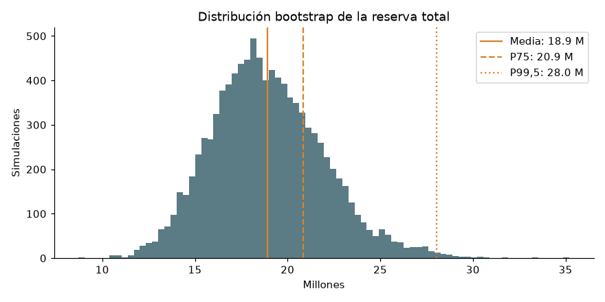
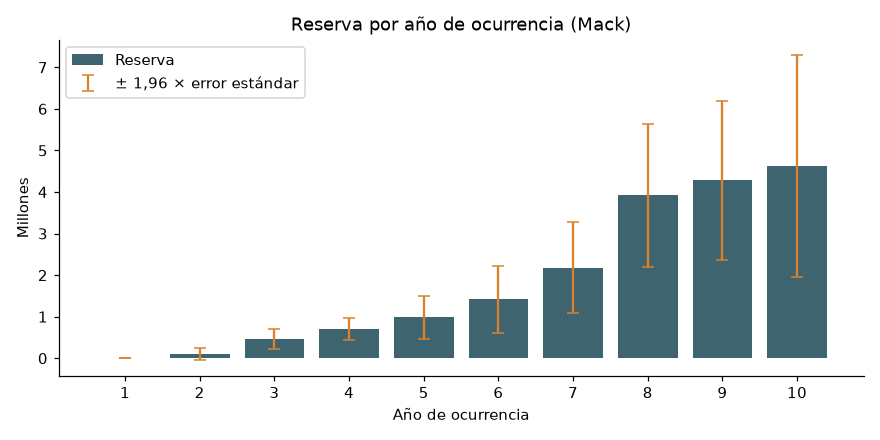

# Reservas de siniestros: Chain Ladder, Mack y bootstrap

> **EN:** Claims reserving in Python from scratch: Chain Ladder, Mack's (1993) prediction error and the ODP bootstrap
> (England & Verrall, 2002), validated against published results with unit tests.

Implementación propia en Python de los métodos de reservas de no vida más usados, desde la estimación
determinista de la reserva (IBNR) hasta su **distribución completa** para medir el riesgo de reservas.
El código está **validado con tests** frente a los resultados publicados en la literatura.



## Resultados clave

Triángulo de pagos de Taylor y Ashe (1983), 10 años de ocurrencia × 10 años de desarrollo.

| Método | Reserva total | Error estándar | CV |
|---|---:|---:|---:|
| Chain Ladder + Mack | 18.680.856 | 2.447.095 | 13,1 % |
| Bootstrap ODP (10.000 simulaciones) | 18.925.133 | 3.026.028 | 16,0 % |

| Percentil de la reserva (bootstrap) | Valor |
|---|---:|
| P75 | 20.850.941 |
| P95 | 24.152.580 |
| P99,5 | 28.030.167 |

- La reserva y el error de Mack coinciden con los publicados por Mack (1993); el error del bootstrap, con el de England y Verrall (2002).
- El bootstrap da más incertidumbre que Mack porque añade el error de proceso de un modelo de Poisson sobredisperso.
- Los años recientes concentran la reserva y la incertidumbre: el año 10 tiene un 25 % de la reserva total y un CV del 29 %.



## Metodología

1. **Chain Ladder.** Factores de desarrollo ponderados por volumen y proyección de cada año hasta su coste último.
2. **Mack (1993).** Error cuadrático medio de predicción por año y total, sin suponer ninguna distribución:
   combina el error de proceso y el de estimación de los factores. El último σ² se extrapola como propone Mack.
3. **Bootstrap ODP (England y Verrall, 2002).**
   - Residuos de Pearson del modelo de Poisson sobredisperso equivalente a Chain Ladder, ajustados por grados de libertad.
   - 10.000 triángulos ficticios por remuestreo de residuos: se reestiman los factores (error de estimación).
   - Pagos futuros simulados con una Gamma de media *m* y varianza φ·*m* (error de proceso).
4. **Capital.** Percentil 99,5 % menos la media, con visión a último. Solvencia II usa la visión a un año
   (por ejemplo, Merz-Wüthrich), para la que este cálculo es el punto de partida.

## Estructura

```
├── data/taylor_ashe_cumulative.csv   triángulo acumulado
├── src/reserving.py                  Chain Ladder, Mack y bootstrap ODP
├── tests/test_reserving.py           validación frente a los resultados publicados
├── notebooks/claims_reserving.ipynb  análisis completo con gráficos
└── figures/                          gráficos del análisis
```

## Cómo ejecutarlo

```bash
pip install -r requirements.txt
python -m unittest discover tests        # 5 tests
jupyter notebook notebooks/claims_reserving.ipynb
```

## Referencias

- Taylor, G. y Ashe, F. (1983). Second moments of estimates of outstanding claims. *Journal of Econometrics*, 23.
- Mack, T. (1993). Distribution-free calculation of the standard error of chain ladder reserve estimates. *ASTIN Bulletin*, 23(2).
- England, P. y Verrall, R. (2002). Stochastic claims reserving in general insurance. *British Actuarial Journal*, 8(3).
- Merz, M. y Wüthrich, M. (2008). Modelling the claims development result for solvency purposes. *CAS E-Forum*.

## Autora

**Tingting Wu**, Máster en Ciencias Actuariales y Financieras (Universitat de València) ·
[LinkedIn](https://www.linkedin.com/in/tingting-wu-8b9320243)
